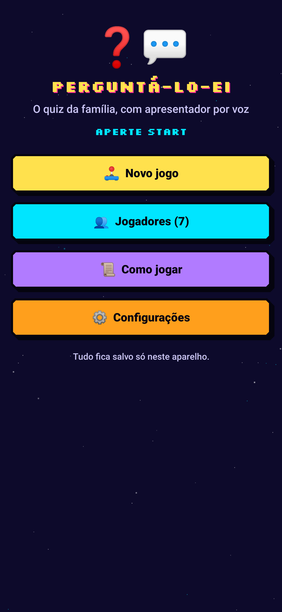
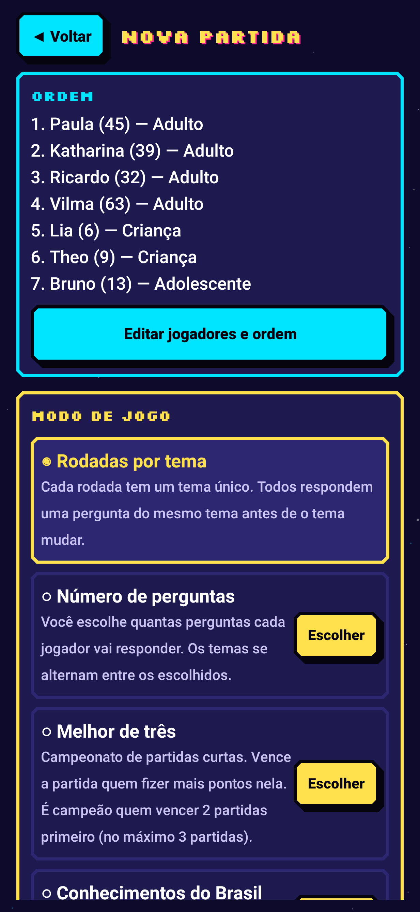
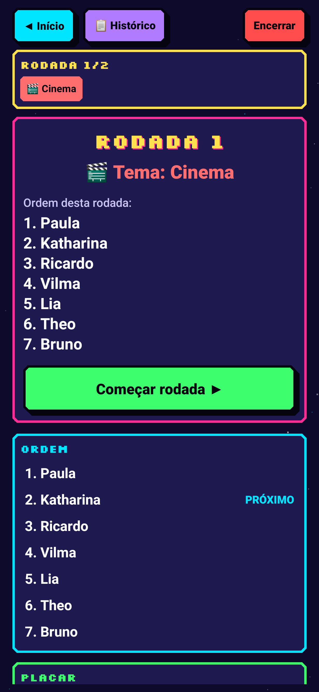
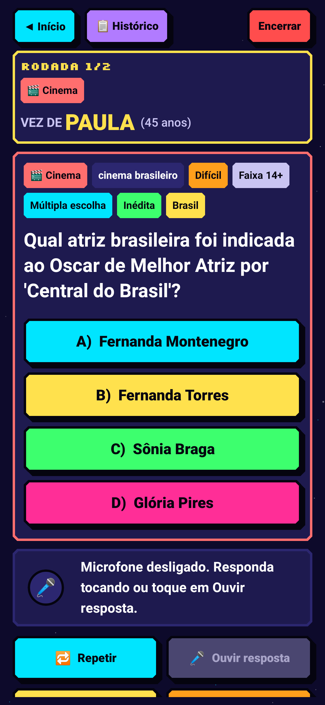
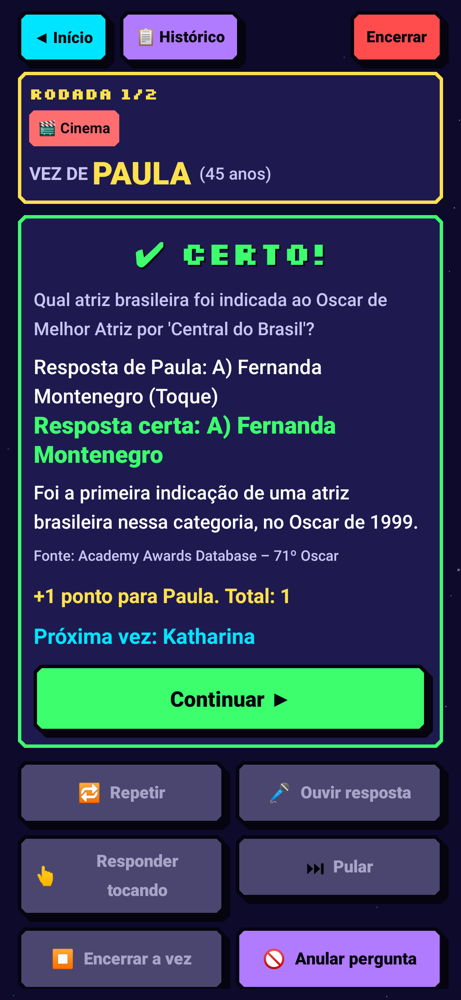
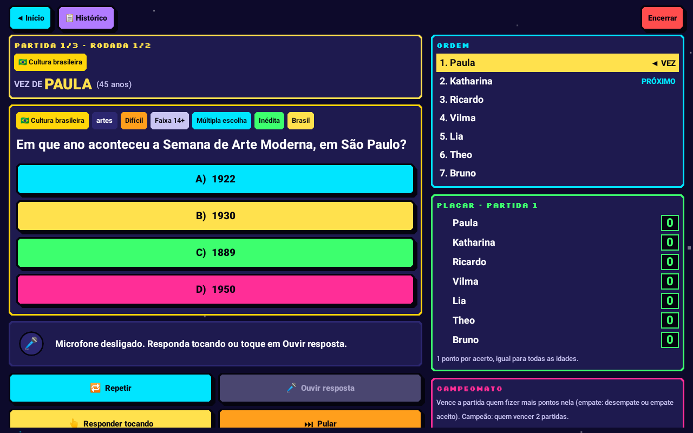

# PERGUNTÁ-LO-EI

Quiz familiar para Android, com **apresentador por voz**, visual de fliperama dos anos 90 e regras que mantêm a ordem dos jogadores e o placar sempre corretos.

<p align="center"></p>

| Início | Configuração | Rodada | Pergunta | Resultado |
|---|---|---|---|---|
|  |  |  |  |  |

Tablet (pergunta e placar lado a lado): 

> As capturas foram geradas automaticamente pelo teste de interface (`TouchUiTest`), com as animações desligadas.

## APK de teste

| Arquivo | Uso |
|---|---|
| [`apk/PERGUNTALOEI-1.0.0-teste.apk`](apk/PERGUNTALOEI-1.0.0-teste.apk) (18 MB) | **Recomendado para testar.** Build *debug*: é exatamente o código coberto pelos testes. |
| [`apk/PERGUNTALOEI-1.0.0-release-minificado.apk`](apk/PERGUNTALOEI-1.0.0-release-minificado.apk) (1,4 MB) | Build *release* com R8 (minificado), assinado com a chave de debug. Compila e passa na verificação de assinatura, mas não foi executado em aparelho. |

Para instalar: copie o APK para o celular e abra-o (permita "instalar apps desconhecidos"), ou `adb install apk/PERGUNTALOEI-1.0.0-teste.apk`. Android 7.0 (API 24) ou superior.

## Estrutura do projeto

```
app/src/main/java/br/com/perguntaloei/
├─ model/       Pergunta, Jogador, Tema, Dificuldade, Modo de jogo, Configuração
├─ questions/   Banco (carga + validação), normalização de texto, quase-duplicatas,
│               seleção por idade/tema/histórico (AgePolicy, QuestionSelector)
├─ game/        Motor de regras puro (GameEngine/GameState), interpretação de respostas
│               (AnswerInterpreter), roteiro do apresentador (PresenterScript)
├─ data/        Armazenamento local com escrita atômica (jogadores, configurações,
│               histórico de perguntas, partida em andamento, partidas anteriores)
├─ voice/       Síntese de voz (VoiceHost/TextToSpeech) e reconhecimento de fala
│               (SpeechInput/SpeechRecognizer), atrás de interfaces testáveis
├─ audio/       Efeitos sonoros 8 bits sintetizados no próprio app (sem arquivos de áudio)
├─ ui/          Telas Compose: início, jogadores, configuração, jogo, histórico, regras, ajustes
├─ AppViewModel.kt  Orquestra motor + voz + microfone + persistência
└─ MainActivity.kt
app/src/main/assets/questions.json   Banco de perguntas (gerado, offline)
app/src/test/                        Testes (JVM + Robolectric)
tools/questions/                     Fonte do banco (parte1-3.py) + validador/gerador
tools/make_icons.py                  Gerador do ícone (adaptativo + PNGs por densidade)
```

## Como compilar

Requisitos: JDK 17+ e Android SDK (platform 35, build-tools 35).

```bash
echo "sdk.dir=/caminho/do/android-sdk" > local.properties
./gradlew testDebugUnitTest      # 61 testes
./gradlew assembleDebug          # app/build/outputs/apk/debug/app-debug.apk
./gradlew assembleRelease        # app/build/outputs/apk/release/app-release.apk
```

Para alterar perguntas: edite `tools/questions/parte*.py` e rode `python3 tools/questions/build_questions.py`
(valida tudo e regrava o `questions.json`; falha se houver erro). Ícones: `python3 tools/make_icons.py`.

## O que foi implementado

**Identidade visual** — tema arcade de alto contraste, fonte pixel (Silkscreen, OFL) só em títulos e texto comum grande nas perguntas; botões grandes com sombra pixelada; céu estrelado, título pulando e "APERTE START" piscando (respeitam "Remover animações" do Android); ícone adaptativo original (balão + "?" em pixel art) com versão monocromática e PNGs mdpi→xxxhdpi; efeitos sonoros originais sintetizados (onda quadrada, volume baixo, podem ser desligados).

**Jogadores** — cadastrar, editar, remover, reordenar (▲▼) ou sortear; idade opcional; nomes repetidos são recusados (o apresentador chama pelo nome). Botão opcional "Usar sugeridos" adiciona Paula 45, Katharina 39, Ricardo 32 e Vilma 63.

**Modos** — Rodadas por tema; Número de perguntas (por jogador, temas alternados); Melhor de três (vence a partida quem fizer mais pontos nela; campeão quem vencer 2 partidas; se após 3 partidas ninguém tiver 2 vitórias, os líderes vão ao desempate — a regra aparece na tela); Conhecimentos do Brasil. Temas e dificuldades escolhidos antes da partida.

**Idades** — até 9 anos: perguntas fáceis; 10–12: fáceis e médias; 13–15: até difíceis; adultos/idade não informada: as dificuldades escolhidas. A faixa etária da pergunta nunca é ultrapassada. Todos recebem o tema da rodada e o acerto vale 1 ponto para todos.

**Condução** — rodada, tema, jogador da vez, ordem (com "PRÓXIMO") e placar sempre visíveis. Uma pergunta por vez; não avança sem avaliação, pulo ou fim da vez. Botões: Repetir, Ouvir resposta, Responder tocando, Pular, Encerrar a vez, Anular pergunta (áudio/interrupção, jogador errado, repetida — troca sem mexer no placar) e Desfazer último ponto. Depois de cada resposta: certo/errado, resposta certa, explicação, fonte, placar e próximo jogador. Empate no fim: pergunta de desempate inédita (não altera o placar) ou empate aceito. "Encerrar" termina a partida com o placar atual.

**Apresentador por voz** — anuncia a vez, tema e dificuldade, lê a pergunta e todas as alternativas com pausas; o microfone só abre quando a fala termina (cada leitura tem uma ficha: aviso atrasado de leitura antiga é ignorado). Indicador vermelho "MICROFONE ATIVO" com Parar e Cancelar; mostra a transcrição parcial e final. Interpretação das respostas:
- "letra B", "alternativa C", "a segunda", o texto da alternativa, "verdadeiro/falso", números falados ("mil oitocentos e vinte e dois");
- dúvida ("acho que…", "será…"), confiança baixa ou correspondência parcial → mostra a transcrição e pede confirmação (toque ou "sim/não" falado);
- duas alternativas citadas, menção negada ("não é a B") ou resposta aberta quase igual → pede esclarecimento; em resposta aberta o jogador pode manter a resposta e o grupo decide;
- "repete", "não entendi" → relê (não é resposta); "passo", "não sei" → pede confirmação antes de pular/encerrar a vez;
- silêncio → "Não ouvi", nenhum ponto. A fala é sempre atribuída ao jogador da vez.

**Banco de perguntas** — **334 perguntas** em 15 temas (146 fáceis, 109 médias, 57 difíceis, 22 muito difíceis; 308 de múltipla escolha, 13 V/F, 13 abertas; 142 sobre o Brasil), cada uma com id, texto, tema, subtema, dificuldade, faixa etária, formato, alternativas, resposta, sinônimos, explicação, fonte e, quando o fato pode mudar, data de referência (ex.: "Censo 2022", "Até a Copa de 2022"). O validador recusa alternativas duplicadas, resposta fora das alternativas, enunciado que contém a resposta e quase-duplicatas. Todos os temas têm pelo menos 4 perguntas para crianças de 6 anos.

**Inéditas e histórico** — nenhuma pergunta (nem quase igual) se repete na partida; o histórico fica no aparelho e é consultado na seleção (por id e por "impressão digital" do enunciado, que pega pequenas reescritas). As perguntas de cada rodada são escolhidas antes de ela começar. Quando as inéditas de um tema acabam, o app avisa e marca "Já usada em partida anterior" — nunca diz "Inédita" sem consultar o histórico. Em Configurações: inéditas por tema e "Limpar histórico".

**Placar e integridade** — o placar é sempre calculado a partir do registro de perguntas avaliadas (não existe outro caminho para mudar pontos). Histórico da partida com jogador, pergunta, resposta dada, forma (voz/toque/digitada/grupo), resultado e ponto; itens desfeitos aparecem riscados. A partida é salva a cada ação (escrita atômica) e retomada após o app ser fechado ou interrompido.

**Privacidade** — o app **não pede permissão de INTERNET**; nomes, idades, respostas e histórico ficam no aparelho; backup em nuvem desativado. Não grava nem guarda áudio. O microfone é pedido só ao tentar responder falando, com explicação antes. Como o reconhecimento de fala do Android pode usar serviço online (geralmente Google), o app mostra um aviso e pede consentimento; recusando, tudo funciona por toque. Também há modo sem voz.

## Validação feita

61 testes automatizados, todos passando (`./gradlew testDebugUnitTest`):

| Requisito | Como foi verificado |
|---|---|
| 7 jogadores, ordem nunca se perde | `GameEngineTest.sevenPlayersKeepStrictTurnOrderThroughRandomActions`: 25 partidas de 8 rodadas com 7 jogadores (incl. 6, 9 e 13 anos) e ações aleatórias (repetir, anular, pular, sem resposta, desfazer, Continuar fora de hora, desempates); confere a vez a cada passo e a ordem de cada rodada. `TouchUiTest` joga uma partida inteira de 7 jogadores pela interface. |
| Respostas certas, erradas, inaudíveis, repetidas, interrompidas | `VoiceFlowTest` (resposta clara, confirmação, "repete", silêncio, interrupção com retomada do disco, desfazer após erro de escuta) e `AnswerInterpreterTest` (17 casos, incluindo falar exatamente cada uma das 334 respostas). |
| Placar só muda com resposta avaliada | `scoreChangesOnlyAfterAnEvaluatedAnswer`, invariante checada a cada passo da simulação, `undoFixesTheLastResultOnlyForThatPlayer`. |
| Repetir não conta nem altera pontos | `repeatIsNotAnAnswerAndChangesNothing`, `askingToRepeatIsNotAnAnswer`. |
| Perguntas usadas não voltam | `usedQuestionsDoNotReturnInLaterGames`, `rewordedQuestionIsDetectedThroughHistoryFingerprint`, `whenFreshQuestionsRunOutTheReuseIsFlagged`, sem repetição/quase-duplicata na simulação. |
| Crianças recebem perguntas adequadas | `childrenReceiveAgeAppropriateQuestions` (criança de 6 anos em todos os temas, mesmo com adultos em "muito difícil") e checagem em todas as simulações. |
| Modo por toque sem microfone | `touchOnlyGameWorksWithoutAnySpeechRecognizer` (ViewModel) e `TouchUiTest` (partida completa por toques, celular e tablet). |
| Microfone só ao esperar resposta | `microphoneOpensOnlyAfterTheQuestionAndOptionsAreRead`, `lateCallbackFromAnInterruptedReadingNeverOpensTheMicrophone`, `microphoneNeverOpensOutsideAQuestion`, `speechNeedsConsentAndPermissionFirst`. |

## Limitações conhecidas

- **Não foi testado em aparelho físico nem em emulador** (o ambiente de desenvolvimento não tem aceleração de hardware para emulador). A interface foi executada com Robolectric; a voz e o microfone foram testados com implementações falsas que seguem o contrato do TextToSpeech/SpeechRecognizer. Vale um teste real de voz: sotaques, ruído da sala e o comportamento do serviço de reconhecimento variam de aparelho para aparelho.
- O reconhecimento de fala depende do serviço instalado (normalmente Google). O app pede processamento no aparelho, mas não consegue garantir que o serviço não use a internet — por isso o aviso e o consentimento. Sem voz em português instalada, o app avisa e segue no modo tela/toque.
- O APK *release* minificado não foi executado; use o APK de teste (*debug*) para avaliação.
- As perguntas foram escritas e revisadas com cuidado, e as fontes indicam onde checar cada fato, mas as referências não foram consultadas online nesta sessão. Recomendo uma revisão humana, especialmente de novelas, marcas/slogans e datas.
- O desempate usa apenas perguntas inéditas; se acabarem, a opção é aceitar o empate.
- "Desfazer último ponto" vale para o resultado exibido na hora (antes de tocar em Continuar). Para resultados anteriores, o histórico mostra tudo, mas não edita.
- A dificuldade é adaptada pela idade; não há ajuste manual de nível por jogador.
- O histórico de perguntas é por aparelho (não sincroniza entre celulares).

## Licenças

Código e perguntas: deste projeto. Fonte Silkscreen © The Silkscreen Project Authors, SIL Open Font License 1.1 (`licenses/Silkscreen-OFL.txt`). Sons e ícone: criados para este app.
